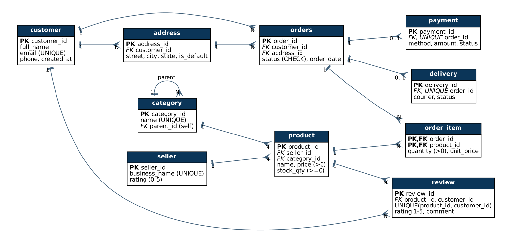

# Portfolio 1 - Database Design and Modelling

## Selected organisation (case study statement)
**NaijaCart** - a *simulated* Nigerian multi-seller e-commerce marketplace (similar in model to Jumia or Konga).

| Item | Description |
|---|---|
| Nature of the system | Online marketplace where independent sellers list products and customers order, pay and track delivery |
| Users of the database | Customers, sellers, warehouse/dispatch staff, finance staff, analysts (read-only) |
| Major data stored | Customers and addresses, sellers, categories (tree), products and stock, orders and order items, payments, deliveries, reviews |
| Key operations | Browse/search catalogue, place order and reduce stock, take payment (card/transfer/USSD/wallet), track delivery, review products, sales reporting |
| Scale simulated | 50,000 customers, 20,000 products, 200,000 orders, 600,000 order items |

The same case study is used in every portfolio (SQL -> transactions -> NoSQL -> distributed).

## Files
| File | Purpose |
|---|---|
| `01_schema.sql` | DDL: 11 tables, keys, constraints |
| `02_seed_data.sql` | Synthetic data generator (`generate_series`, fixed `setseed` so every run produces identical data) |
| `03_roles_security.sql` | Database roles, least-privilege grants, anonymised analyst view |
| `04_test_roles.sh` | Proves the permissions work (`results/04_roles_output.txt`) |
| `results/row_counts.txt` | Row counts after seeding |
| `diagrams/erd.dot`, `diagrams/erd.png` | ER diagram (Graphviz source + image) |

## ER diagram


## Relational schema (keys)
```
customer(PK customer_id, full_name, email UNIQUE, phone, created_at)
address(PK address_id, FK customer_id, street, city, state, is_default)
category(PK category_id, name UNIQUE, FK parent_id -> category)
seller(PK seller_id, business_name UNIQUE, rating)
product(PK product_id, FK seller_id, FK category_id, name, price, stock_qty)
orders(PK order_id, FK customer_id, FK address_id, status, order_date)
order_item(PK(order_id, product_id), FK order_id, FK product_id, quantity, unit_price)
payment(PK payment_id, FK order_id UNIQUE, method, amount, status, paid_at)
delivery(PK delivery_id, FK order_id UNIQUE, courier, status, updated_at)
review(PK review_id, FK product_id, FK customer_id, rating, comment, UNIQUE(product_id, customer_id))
stock_log(PK log_id, FK product_id, change_qty, reason, logged_at)   -- audit trail for Portfolio 3
```
Relationships: customer 1-N address; customer 1-N orders; orders M-N product resolved by `order_item`; orders 1-0..1 payment and delivery; category self-reference (tree); seller 1-N product; product M-N customer via `review`.

## Data dictionary (core tables)
| Table.column | Type | Null? | Rule / meaning |
|---|---|---|---|
| customer.email | VARCHAR(160) | NOT NULL | UNIQUE; basic format CHECK; login identifier |
| product.price | NUMERIC(12,2) | NOT NULL | > 0; exact decimal (never FLOAT for money) |
| product.stock_qty | INT | NOT NULL | >= 0; decremented only inside transactions (Portfolio 3) |
| orders.status | VARCHAR(12) | NOT NULL | PENDING, PAID, SHIPPED, DELIVERED or CANCELLED |
| order_item.unit_price | NUMERIC(12,2) | NOT NULL | Price at time of purchase (historical snapshot) |
| payment.method | VARCHAR(12) | NOT NULL | CARD, TRANSFER, USSD or WALLET (common Nigerian channels) |
| payment.amount | NUMERIC(14,2) | NOT NULL | Amount actually charged |
| delivery.courier | VARCHAR(60) | NOT NULL | Logistics partner handling the order |
| review.rating | SMALLINT | NOT NULL | 1-5; one review per customer per product |

All primary keys use `GENERATED ALWAYS AS IDENTITY` (SQL-standard surrogate keys that the application cannot overwrite by accident).

## Constraints used (and why)
| Constraint | Business rule enforced |
|---|---|
| `CHECK (stock_qty >= 0)` | Stock can never go negative - last line of defence against overselling |
| `CHECK (price > 0)`, `CHECK (quantity > 0)` | No free/negative items |
| `CHECK (status IN (...))` on orders, payment, delivery | Only valid lifecycle states |
| `UNIQUE (email)` | One account per email |
| `UNIQUE (order_id)` on payment and delivery | At most one payment and one delivery per order |
| `UNIQUE (product_id, customer_id)` on review | One review per customer per product |
| `PRIMARY KEY (order_id, product_id)` | A product appears once per order (quantity holds the count) |
| `ON DELETE CASCADE` on address and order_item | Child rows removed with their parent; **no** cascade on orders/payments so financial history cannot be deleted by accident |

## Normalisation explanation
Starting point (an unnormalised "order sheet" a small shop might keep in a spreadsheet):

`Order(order_id, order_date, customer_name, customer_email, customer_phone, delivery_address, product1_name, product1_price, product1_qty, product2_name, ..., seller_name, category_name, payment_method, payment_amount)`

1. **1NF** - remove repeating groups and make values atomic. `product1..productN` columns become rows of `order_item`; addresses become their own table because a customer can have several.
2. **2NF** - remove partial dependencies on part of a composite key. In `order_item(order_id, product_id, ...)`, `product_name` depends only on `product_id`, so it moves to `product`. Only `quantity` and `unit_price` depend on the *whole* key and stay.
3. **3NF** - remove transitive dependencies (non-key -> non-key). `customer_name/email` depend on `customer_id`, not on `order_id` (moved to `customer`); `seller_name` depends on `seller_id`, not on `product_id` (moved to `seller`); `category_name` moved to `category`.

**Functional dependencies of the final schema (each determinant is a key, so every table is also in BCNF):**
```
customer_id            -> full_name, email, phone, created_at      email -> customer_id (candidate key)
address_id             -> customer_id, street, city, state, is_default
category_id            -> name, parent_id                          name  -> category_id (candidate key)
seller_id              -> business_name, rating                    business_name -> seller_id (candidate key)
product_id             -> seller_id, category_id, name, price, stock_qty, created_at
order_id               -> customer_id, address_id, status, order_date
(order_id, product_id) -> quantity, unit_price
payment_id             -> order_id, method, amount, status, paid_at   order_id -> payment_id (candidate key)
(product_id, customer_id) -> review_id, rating, comment             review_id -> product_id, customer_id, ...
```
Every determinant above is a candidate key, which is the BCNF condition (stronger than 3NF).

*Considered and rejected:* `city -> state` looks like a transitive dependency in `address`. It is not treated as a real FD because a town name alone does not reliably identify a state, so splitting it out would add a join without removing a genuine anomaly. A `state` lookup table (36 states + FCT) would be the next step if state-level validation were needed.

Result: every non-key attribute depends on "the key, the whole key and nothing but the key". This removes update anomalies (change a seller name once), insertion anomalies (add a category with no products) and deletion anomalies (deleting an order does not delete the customer).

**Deliberate, documented denormalisation**
- `order_item.unit_price` copies `product.price` at purchase time. This is *not* redundancy: prices change, and the invoice must keep the historical price.
- `payment.amount` could be derived from the items, but is stored because it is the amount actually charged (it may include delivery fees/discounts in a real system) and is needed for audit.

## Database users and access control (`03_roles_security.sql`)
| Role | Can do | Cannot do |
|---|---|---|
| `naijacart_app` (web application) | Read catalogue; insert/update orders, payments, deliveries, reviews; update `product.stock_qty` only | Delete orders or payments (keeps the financial audit trail) |
| `naijacart_analyst` | Read `v_sales_anonymised` (orders, items, delivery **state** only), products, categories, sellers | See any customer name, email, phone or street (NDPA 2023 data minimisation) |
| `naijacart_finance` | Read payments and orders | Change anything |

Tested in `results/04_roles_output.txt`: the analyst login read 600,000 rows from the anonymised view, then got `permission denied for table customer` when selecting emails and `permission denied for table orders` when trying to delete an order.

## How to run
```bash
psql -d shopnaija -f 01_schema.sql
psql -d shopnaija -f 02_seed_data.sql
psql -d shopnaija -f 03_roles_security.sql && ./04_test_roles.sh
dot -Tpng diagrams/erd.dot -o diagrams/erd.png   # regenerate the diagram
```
